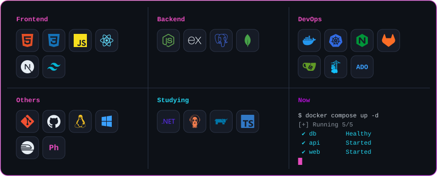
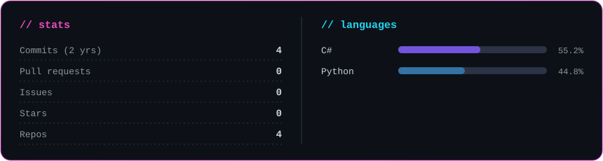
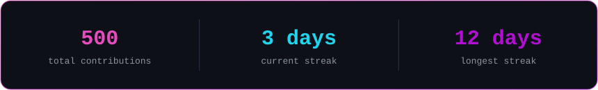
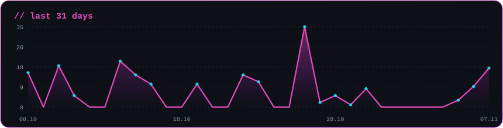
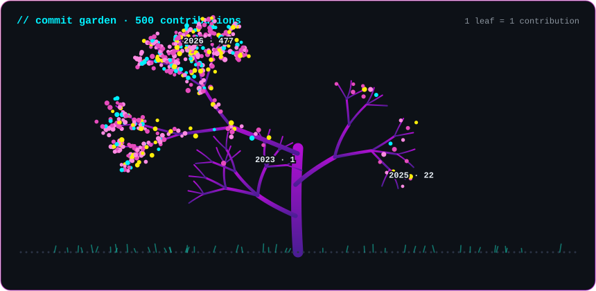

  
  
  

<a href="https://ascii.rest/banner/">
  <picture>
    <source media="(prefers-color-scheme: dark)" srcset="https://ascii.rest/banner/Berkay%20Tan.dark.svg?color=fcee0a,00f0ff,ff2a9d&effect=type&tagline=DevOps%20x%20JavaScript&size=s&bg=353e4b">
    
  </picture>
</a>

 

## About

I have 10 years of enterprise systems experience. I started my career in user services and physical server management, then moved into CI/CD and DevOps culture.

My main focus now is building end-to-end system architectures and blending them with JavaScript to ship stable projects.

| Area | Details |
|---|---|
| **Infrastructure & operations** | From physical servers to Docker and Kubernetes based microservice architectures |
| **Engineering discipline** | Instead of leaning on piles of auto-generated code, I know the load and architectural cost of every line I write. I stand up even the simplest test environment with production-ready rigor |
| **Main focus** | Combining DevOps culture and architecture design with JavaScript; building consistent systems from infrastructure to interface |
| **Side projects** | JavaScript full-stack web solutions that digitize data tracking, operations and customer workflows for small businesses |
| **Hobby** | Experimenting with 2D game mechanics in Phaser.js to try out different software paradigms |

 

## Skill Set

 

## Activity

<picture>
  <source media="(prefers-color-scheme: dark)" srcset="https://raw.githubusercontent.com/BerkayTann/BerkayTann/output/snake.svg?v=3">
  
</picture>

 

 

## The Deep End

 

## Contact

  
  
  

