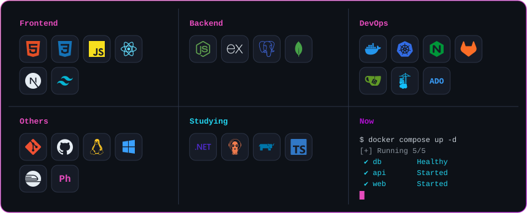
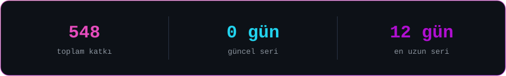
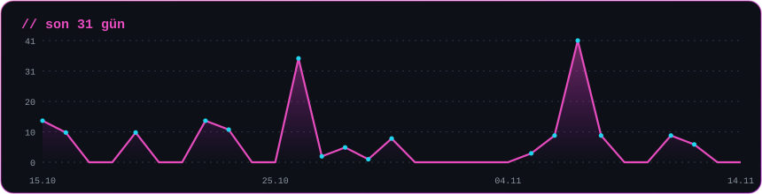
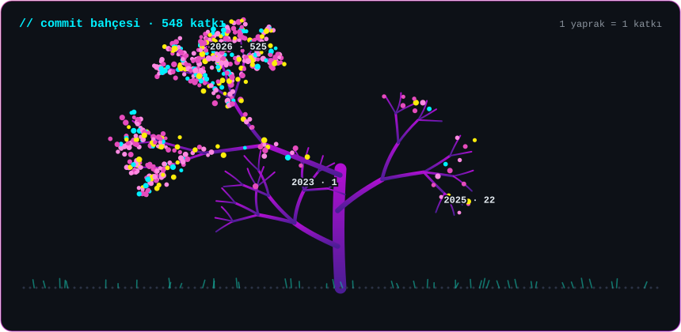

  
  
  

<a href="https://ascii.rest/banner/">
  <picture>
    <source media="(prefers-color-scheme: dark)" srcset="https://ascii.rest/banner/Berkay%20Tan.dark.svg?color=fcee0a,00f0ff,ff2a9d&effect=type&tagline=DevOps%20x%20JavaScript&size=s&bg=353e4b">
    
  </picture>
</a>

 

## Hakkımda

10 yıllık kurumsal sistem tecrübesine sahibim. Kariyerime kullanıcı hizmetleri ve fiziksel sunucu yönetimi ile başladım; zamanla CI/CD süreçlerine ve DevOps kültürüne geçtim.

Şu anki ana odağım, uçtan uca sistem mimarileri kurmak ve bunu JavaScript ile harmanlayarak stabil projeler geliştirmek.

| | |
|---|---|
| **Altyapı ve operasyon** | Fiziksel sunuculardan Docker ve Kubernetes tabanlı mikroservis mimarilerine uzanan sistem yönetimi tecrübesi |
| **Geliştirme disiplini** | Otomatik üretilmiş kod yığınlarına bel bağlamak yerine, yazdığım her satırın sunucuya bindireceği yükü ve mimari maliyetini bilerek ilerlerim. En basit test ortamını bile production-ready titizliğiyle ayağa kaldırırım |
| **Ana odak** | DevOps kültürü ile mimari tasarımı JavaScript'le birleştirmek; altyapıdan arayüze tutarlı sistemler inşa etmek |
| **Yan projeler** | Küçük işletmelerin veri takibini, operasyonlarını ve müşteri iş akışlarını dijitalleştiren JavaScript full-stack web çözümleri |
| **Hobi** | Farklı yazılım paradigmalarını test etmek için Phaser.js ile 2D oyun mekanikleri üzerinde denemeler |

 

## Beceriler

 

## Aktivite

<picture>
  <source media="(prefers-color-scheme: dark)" srcset="https://raw.githubusercontent.com/BerkayTann/BerkayTann/output/snake.svg">
  
</picture>

 

 

## Derin Sular

 

## İletişim

  
  
  

